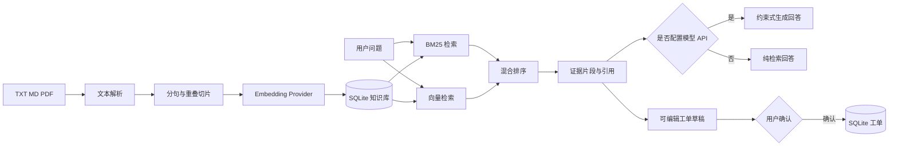

# CitationFlow 知识库 RAG

一个可本地运行的知识库问答系统，支持 TXT、Markdown 和 PDF 文档上传、切片、向量化、BM25 + 向量混合检索、引用溯源及可选的大模型回答生成。默认 Hash 向量只用于离线演示；接入提供 OpenAI 兼容 Embeddings API 的中文语义模型后，才有语义检索能力。项目包含证据不足拒答、模型引用编号检查和可复现评测。

## 项目价值

很多 RAG 演示只展示“上传文档后聊天”，却无法说明检索结果来自哪里。本项目将引用证据作为主要输出：回答返回对应文档、知识片段和相关度，便于检查模型是否真正依据知识库作答。

## 核心能力

- TXT、Markdown、PDF 文档解析
- 基于 SHA-256 的重复文档检测
- 带重叠窗口的文本切片
- 本地确定性 Hash 向量化，离线即可运行（词面演示，非语义模型）
- OpenAI 兼容 Embeddings API，可配置独立于聊天模型的服务地址与密钥
- BM25 与向量相似度混合检索
- SQLite 文档、片段与向量持久化
- 使用原始词面覆盖率等独立证据条件决定是否回答；拒答时仍展示候选片段供人工检查
- 引用优先的约束式回答提示词与引用编号检查
- 未配置模型时自动降级为纯检索模式
- DeepSeek 等 OpenAI 兼容 Chat API
- 文档管理与问答 Web 界面
- 可编辑工单草稿、人工确认后持久化、工单状态查询／更新
- 多文档、有答案／无答案样例集；Hit@1、Hit@5、MRR、拒答率和延迟评测
- FastAPI 接口测试与核心算法单元测试
- Docker 部署

## 系统架构



## 技术栈

- Python 3.11+
- FastAPI
- SQLite
- NumPy
- HTTPX
- pypdf
- 原生 HTML、CSS、JavaScript
- pytest
- Docker

## 快速开始

### 1. 创建环境

```bash
python -m venv .venv
```

Windows：

```powershell
.venv\Scripts\activate
pip install -r requirements.txt
```

macOS / Linux：

```bash
source .venv/bin/activate
pip install -r requirements.txt
```

### 2. 配置环境变量

```bash
cp .env.example .env
```

Windows PowerShell：

```powershell
Copy-Item .env.example .env
```

不填写 API Key 也能运行，系统会使用本地 Hash Embedding 和检索结果展示模式。Hash 向量基于字符／词元哈希，没有训练出的语义关系；换一种说法提问时可能检索不到。Web 界面的“相对排序分”只表示当前候选片段内部的顺序，不是回答正确概率。
纯检索模式会在回答区摘录最相关片段中的匹配句子，完整候选片段仍在下方展示；摘录不是模型生成的结论。

### 3. 启动

```bash
uvicorn app.main:app --reload
```

打开：

- Web 界面：<http://127.0.0.1:8000>
- Swagger：<http://127.0.0.1:8000/docs>
- 健康检查：<http://127.0.0.1:8000/health>

可以上传 `sample_docs/` 中的四份虚构示例文档进行测试。

## 模型配置

### 仅使用本地检索

```dotenv
RAG_EMBEDDING_PROVIDER=hash
RAG_API_KEY=
```

该模式不会访问外部模型，适合演示和自动化测试。Hash Embedding 是词元哈希，不代表中文语义检索效果。

### 使用 OpenAI 兼容 Chat API

```dotenv
RAG_API_BASE_URL=https://api.deepseek.com
RAG_API_KEY=your-key
RAG_CHAT_MODEL=deepseek-chat
```

### 使用 OpenAI 兼容 Embeddings API

先准备一个已经部署、提供 `/v1/embeddings` 接口的中文语义向量服务；其 `model` 名称以服务实际配置为准。本项目不自动下载大模型。示例（地址与名称均为占位符）：

```dotenv
RAG_EMBEDDING_PROVIDER=api
RAG_EMBEDDING_API_BASE_URL=https://your-embedding-provider.example.com
RAG_EMBEDDING_API_KEY=your-embedding-key
RAG_EMBEDDING_MODEL=your-chinese-embedding-model
```

聊天模型与向量模型可以来自不同服务。`RAG_API_*` 只供聊天接口使用；`RAG_EMBEDDING_API_*` 只供向量接口使用。启动时会记录向量服务和模型标识。若已有文档索引与配置不同，应用会拒绝启动；请设置新的 `RAG_DB_PATH`，重新上传原文建立索引。升级前创建的旧数据库没有模型标识，也需要重建索引。

若使用兼容 OpenAI 接口的本地服务，可将 `RAG_EMBEDDING_API_BASE_URL` 指向本地地址，并按服务要求配置密钥。真实模型的检索质量与拒答阈值需要使用自己的标注问题重新评估，不能沿用 Hash 演示结果。

### 证据不足时拒答

系统先检索，再计算查询词元在候选片段中的**绝对覆盖率**和命中数。默认同时要求覆盖率至少 `0.25`、命中词元至少 `2`；可通过 `RAG_MIN_LEXICAL_COVERAGE`、`RAG_MIN_MATCHED_TERMS` 调整。使用真实语义向量服务时，还可设置 `RAG_MIN_SEMANTIC_SCORE`，以余弦相似度作为另一条证据通路；默认为 `0`（关闭），因为不同模型的分数不能共用固定阈值。需要在自己的无答案数据上校准该值。

这只是保守的启发式门槛，不是“答案存在”的证明。同主题但询问文档没有给出的具体数值／期限时，词面覆盖率仍可能很高。模型回答会检查是否包含合法引用编号，但**合法编号也不能证明每个陈述得到原文支持**；正式使用时仍需人工核对，后续可加入逐句事实核验。

## API

### 上传文档

```http
POST /api/documents
Content-Type: multipart/form-data
```

### 文档列表

```http
GET /api/documents
```

### 删除文档

```http
DELETE /api/documents/{document_id}
```

### 知识问答

```http
POST /api/query
Content-Type: application/json

{
  "question": "项目发布后需要做什么？",
  "top_k": 5
}
```

响应包含回答模式、证据判断、答案和可追溯片段：

```json
{
  "answer": "发布完成后需要执行冒烟测试并记录回滚方案。[1]",
  "generation_mode": "llm",
  "answerable": true,
  "evidence_reason": "通过最低证据条件；请继续核对原文。",
  "citations": [
    {
      "rank": 1,
      "document_name": "project_handbook.md",
      "chunk_id": 3,
      "content": "...",
      "score": 0.93
    }
  ]
}
```

## 人工确认的工单流程

网页可把当前提问转成工单草稿。`POST /api/tickets/draft` 仅根据问题内容给出可编辑标题、描述和初步分类，不写数据库，也不调用大模型；因此这一步属于规则草稿，不宣称为 AI 自动决策。用户在界面核对并勾选确认后，`POST /api/tickets` 才会保存。API 同样要求 `confirmed: true`，缺失或为 `false` 时返回 422。`GET /api/tickets` 可查看工单及状态，`PATCH /api/tickets/{id}` 可更新为 `open`、`in_progress` 或 `resolved`。

这演示了问答后的受控业务操作。当前无登录与权限管理，只适合本地作品集演示；如需多人使用，应先增加身份校验、操作审计和工单归属。

## 混合检索设计

项目同时计算：

1. BM25 关键词相关度；
2. 查询向量与知识片段向量的余弦相似度；
3. 两类得分归一化后的加权结果。

默认向量权重由 `RAG_HYBRID_ALPHA=0.65` 控制。中文文本会生成汉字 unigram、bigram 以及英文数字词元，以支持离线演示。`score` 是归一化后的**相对排序分**；拒答判断不会只依据该分数。真实向量的相似度使用向量范数计算余弦值。

## 检索评测

```bash
python -m eval.evaluate
```

评测数据位于 `eval/dataset.json`。四份文档、27 道问题均为人工编写的**虚构样例**，包含 17 道有答案问题和 10 道无答案问题。每道有答案问题标明目标文档及原文片段；脚本对 BM25、混合检索和向量排序分别输出：

- Hit@1 / Hit@5、MRR：期望原文片段的排序情况；
- `positive_evidence_acceptance`：有答案问题通过证据门槛的比例；
- `accepted_with_expected_evidence_at_5`：通过门槛且目标片段进入前五的比例（**不是生成答案忠实度**）；
- `no_answer_rejection`：无答案问题被拒答的比例；
- 检索耗时 P50 / P95：在当前机器和配置下测得，非服务端容量指标。

可用 `python -m eval.evaluate --details` 查看逐题结果，或 `--output data/my-eval.json` 导出完整 JSON。当前默认 Hash 配置在这组样例中仍会误答“同主题、缺少具体时长／数值”的 3 道问题：无答案拒答率为 7/10。该结果只用于展示失败案例与调参流程，不能写成真实业务效果。面试或简历中应先使用独立、人工标注的业务问题重新测评，并报告测试集规模和模型版本。

## 测试

```bash
pytest -q
```

测试覆盖：

- 文本清洗与切片；
- 混合检索排序；
- 真正的余弦相似度与零向量处理；
- 外部 Embeddings API 的配置和响应顺序；
- 向量模型切换时的索引保护；
- 文档上传、查询和删除 API；
- 未配置模型时的检索降级与无答案拒答路径。

## Docker

```bash
Copy-Item .env.example .env
docker compose up --build
```

知识库数据保存在宿主机的 `data` 目录。

## 目录结构

```text
knowledge-base-rag/
├── app/
│   ├── static/          # Web 界面
│   ├── chunking.py      # 文本清洗与切片
│   ├── config.py        # 环境配置
│   ├── database.py      # SQLite 持久化
│   ├── embeddings.py    # 本地与 API 向量化
│   ├── generation.py    # 带引用约束的回答生成
│   ├── ingestion.py     # 文档解析与入库
│   ├── main.py          # FastAPI 入口
│   └── retrieval.py     # BM25 + 向量混合检索
├── eval/                # 检索评测数据与脚本
├── sample_docs/         # 四份虚构示例知识文档
├── tests/               # 自动化测试
├── Dockerfile
├── docker-compose.yml
└── requirements.txt
```

## 隐私与安全

- API Key 只通过环境变量配置，`.env` 已加入 `.gitignore`。
- 上传文档默认保存在本地 SQLite，不会自动发送到第三方。
- 只有配置外部 Embeddings 或 Chat API 时，相应文本才会被发送给指定服务商。
- 当前版本没有用户登录和租户隔离，不适合直接暴露在公网处理敏感资料。
- 页面与 API 使用同源访问；默认未开启跨域访问，以免其他网页直接读取本机知识库数据。
- 公网部署前应增加鉴权、文件扫描、请求限流、日志脱敏和数据删除策略。

## 当前限制

- 离线 Hash Embedding 主要保证可运行性，语义理解能力弱于专业中文向量模型。
- PDF 仅提取文本，不支持扫描图片 OCR、表格结构和页码级引用。
- SQLite 适合个人演示，不适合高并发和多实例部署。
- 词面证据门槛对“主题相关但所求细节缺失”存在误答；模型引用编号检查不能验证回答忠实性。
- 评测数据为小规模虚构样例，没有覆盖复杂表格、长文档、跨文档推理和真实用户问法。
- 暂未实现重排序模型、对话记忆和权限过滤。

## 后续计划

- 用可复现的中文语义向量服务和独立业务数据校准阈值；加入 reranker
- 增加页码和段落级引用
- 增加逐句答案忠实度评测与基于证据的数值检查
- 增加用户、知识库和文档权限
- 增加流式回答和查询历史
- 增加 PostgreSQL + pgvector 部署方案

## License

MIT License。项目用于学习、求职作品集和 RAG 工程实践。
