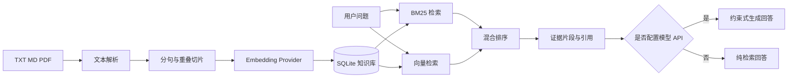

# CitationFlow 知识库 RAG

一个可本地运行的知识库问答系统，支持 TXT、Markdown 和 PDF 文档上传、切片、向量化、BM25 + 向量混合检索、引用溯源及可选的大模型回答生成。即使不配置任何 API，也可以使用离线检索模式运行和测试完整流程。

## 项目价值

很多 RAG 演示只展示“上传文档后聊天”，却无法说明检索结果来自哪里。本项目将引用证据作为主要输出：回答返回对应文档、知识片段和相关度，便于检查模型是否真正依据知识库作答。

## 核心能力

- TXT、Markdown、PDF 文档解析
- 基于 SHA-256 的重复文档检测
- 带重叠窗口的文本切片
- 本地确定性向量化，离线即可运行
- OpenAI 兼容 Embeddings API 扩展
- BM25 与向量相似度混合检索
- SQLite 文档、片段与向量持久化
- 引用优先的约束式回答提示词
- 未配置模型时自动降级为纯检索模式
- DeepSeek 等 OpenAI 兼容 Chat API
- 文档管理与问答 Web 界面
- Hit@5 与 MRR 检索评测脚本
- FastAPI 接口测试与核心算法单元测试
- Docker 部署

## 系统架构



## 技术栈

- Python 3.11+
- FastAPI
- SQLite
- NumPy
- HTTPX
- pypdf
- 原生 HTML、CSS、JavaScript
- pytest
- Docker

## 快速开始

### 1. 创建环境

```bash
python -m venv .venv
```

Windows：

```powershell
.venv\Scripts\activate
pip install -r requirements.txt
```

macOS / Linux：

```bash
source .venv/bin/activate
pip install -r requirements.txt
```

### 2. 配置环境变量

```bash
cp .env.example .env
```

Windows PowerShell：

```powershell
Copy-Item .env.example .env
```

不填写 API Key 也能运行，系统会使用本地 Hash Embedding 和检索结果展示模式。

### 3. 启动

```bash
uvicorn app.main:app --reload
```

打开：

- Web 界面：<http://127.0.0.1:8000>
- Swagger：<http://127.0.0.1:8000/docs>
- 健康检查：<http://127.0.0.1:8000/health>

上传 `sample_docs/project_handbook.md` 后即可测试知识库问答。

## 模型配置

### 仅使用本地检索

```dotenv
RAG_EMBEDDING_PROVIDER=hash
RAG_API_KEY=
```

该模式不会访问外部模型，适合演示、测试和隐私敏感环境。Hash Embedding 是轻量离线方案，用于保证项目开箱即用，不代表生产级语义模型效果。

### 使用 OpenAI 兼容 Chat API

```dotenv
RAG_API_BASE_URL=https://api.deepseek.com
RAG_API_KEY=your-key
RAG_CHAT_MODEL=deepseek-chat
```

### 使用 OpenAI 兼容 Embeddings API

服务端需要提供 `/v1/embeddings` 接口：

```dotenv
RAG_EMBEDDING_PROVIDER=api
RAG_API_BASE_URL=https://your-provider.example.com
RAG_API_KEY=your-key
RAG_EMBEDDING_MODEL=your-embedding-model
```

更换向量模型后应使用新的数据库重新建立索引，避免不同维度或不同分布的向量混用。

## API

### 上传文档

```http
POST /api/documents
Content-Type: multipart/form-data
```

### 文档列表

```http
GET /api/documents
```

### 删除文档

```http
DELETE /api/documents/{document_id}
```

### 知识问答

```http
POST /api/query
Content-Type: application/json

{
  "question": "项目发布后需要做什么？",
  "top_k": 5
}
```

响应包含回答模式、答案和可追溯引用：

```json
{
  "answer": "发布完成后需要执行冒烟测试并记录回滚方案。[1]",
  "generation_mode": "llm",
  "citations": [
    {
      "rank": 1,
      "document_name": "project_handbook.md",
      "chunk_id": 3,
      "content": "...",
      "score": 0.93
    }
  ]
}
```

## 混合检索设计

项目同时计算：

1. BM25 关键词相关度；
2. 查询向量与知识片段向量的余弦相似度；
3. 两类得分归一化后的加权结果。

默认向量权重由 `RAG_HYBRID_ALPHA=0.65` 控制。中文文本会生成汉字 unigram、bigram 以及英文数字词元，以支持离线演示。

## 检索评测

```bash
python -m eval.evaluate
```

评测数据位于 `eval/dataset.json`，当前输出：

- Hit@5：期望证据是否进入前五条结果；
- MRR：首条正确证据排名的倒数均值。

示例数据规模很小，只用于验证评测链路。扩充项目时应增加真实业务问题、无答案问题、相似问题和容易混淆的问题。

## 测试

```bash
pytest -q
```

测试覆盖：

- 文本清洗与切片；
- 混合检索排序；
- 文档上传、查询和删除 API；
- 未配置模型时的检索降级路径。

## Docker

```bash
Copy-Item .env.example .env
docker compose up --build
```

知识库数据保存在宿主机的 `data` 目录。

## 目录结构

```text
knowledge-base-rag/
├── app/
│   ├── static/          # Web 界面
│   ├── chunking.py      # 文本清洗与切片
│   ├── config.py        # 环境配置
│   ├── database.py      # SQLite 持久化
│   ├── embeddings.py    # 本地与 API 向量化
│   ├── generation.py    # 带引用约束的回答生成
│   ├── ingestion.py     # 文档解析与入库
│   ├── main.py          # FastAPI 入口
│   └── retrieval.py     # BM25 + 向量混合检索
├── eval/                # 检索评测数据与脚本
├── sample_docs/         # 示例知识文档
├── tests/               # 自动化测试
├── Dockerfile
├── docker-compose.yml
└── requirements.txt
```

## 隐私与安全

- API Key 只通过环境变量配置，`.env` 已加入 `.gitignore`。
- 上传文档默认保存在本地 SQLite，不会自动发送到第三方。
- 只有配置外部 Embeddings 或 Chat API 时，相应文本才会被发送给指定服务商。
- 当前版本没有用户登录和租户隔离，不适合直接暴露在公网处理敏感资料。
- 公网部署前应增加鉴权、文件扫描、请求限流、日志脱敏和数据删除策略。

## 当前限制

- 离线 Hash Embedding 主要保证可运行性，语义理解能力弱于专业中文向量模型。
- PDF 仅提取文本，不支持扫描图片 OCR、表格结构和页码级引用。
- SQLite 适合个人演示，不适合高并发和多实例部署。
- 暂未实现重排序模型、对话记忆和权限过滤。

## 后续计划

- 接入 BGE 中文向量模型与 reranker
- 增加页码和段落级引用
- 增加无答案检测与答案忠实度评测
- 增加用户、知识库和文档权限
- 增加流式回答和查询历史
- 增加 PostgreSQL + pgvector 部署方案

## License

MIT License。项目用于学习、求职作品集和 RAG 工程实践。

